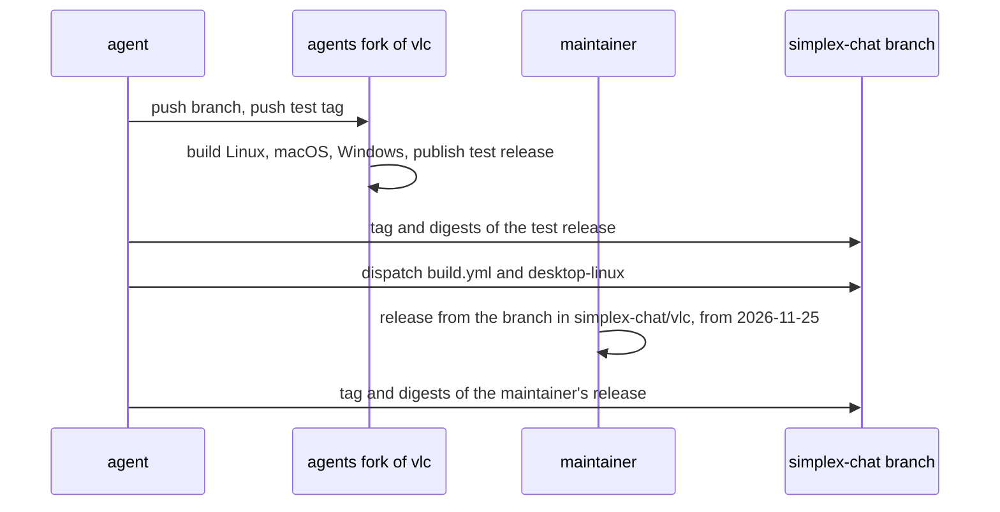

# Desktop VLC upgrade

## Change

1. VLC fork, branch from tag 3.0.24:
   - the fork's CI and packaging commits of 3.0.23-2, rebased;
   - 3.0.x commits after 3.0.24: ad36aff096, 682660f248, 064163b7d8, 04e8b515d5, 4ef678c027, 055db45c63;
   - master commits of modules/demux/nuv.c, backported to the 3.0 types: 17f65c0cba, dc11ad779b, c95158d813, 6c40003ec6, f4a1bcb444, 1d712ec616, b6aa1fb57e, 319b421185;
   - contrib versions of the table below;
   - CI: the Debian and Ubuntu archives of one snapshot, the containers by digest, the build tools by SHA-256, the checkout without the token, the package list of each Linux build as a release asset.
2. simplex-chat:
   - prepare-vlc-linux.sh, prepare-vlc-mac.sh, prepare-vlc-windows.sh: the release tag and a SHA-256 per asset, checked before extraction;
   - Main.kt: on Windows, libvlccore.dll and libvlc.dll loaded; prepare-vlc-windows.sh copies these two;
   - desktop-linux: the app with the VLC bundle of prepare-vlc-linux.sh; the smoke test sends a video, made by ffmpeg on the runner.

| Library | 3.0.23-2 | 3.0.24 | Fork branch |
|---|---|---|---|
| VLC | 3.0.23 | 3.0.24 | 3.0.24 and the commits above |
| libass | 0.17.3 | 0.17.5 | 0.17.5 |
| FreeType | 2.13.1 | 2.14.3 | 2.15.0 |
| libpng | 1.6.50 | 1.6.58 | 1.6.59 |
| libxml2 | 2.9.14 | 2.15.3 | 2.15.4 |
| libarchive | 3.8.0 | 3.8.9 | 3.8.11 |
| libvpx | 1.15.2 | 1.16.0 | 1.17.0 |
| mpg123 | 1.30.1 | 1.33.6 | 1.33.7 |
| srt | 1.5.3 | 1.5.6 | 1.5.7 |
| FFmpeg | 4.4.5 | 8.1.2 | 8.1.2 |
| GnuTLS | 3.8.10 | 3.8.13 | 3.8.13 |
| libmodplug | 0.8.9.0 | 0.8.9.0 | 0.8.9.0 |

The Linux bundle is VLC 3.0.24 built against the Debian 12 packages of snapshot 20261111T002405Z of snapshot.debian.org.

## Dates

| From | Step |
|---|---|
| 2026-11-25 | build of the release: every package of the snapshot is 14 days old |
| 2026-11-29 | libmodplug 0.8.9.2; 3.0.x commits fb916cd7cd and 6b24ce03d4 |
| 2026-12-02 | GnuTLS 3.8.14 |
| 2026-12-04 | FFmpeg 9.1 |

The steps from 2026-11-29 are a second release of the fork.

## Verification

- Fork release: five bundles and two package lists; the GitHub digest of each asset equals the script's SHA-256.
- Package lists: the Debian revisions of libssh2, libssh, libass, libarchive, OpenSSL, srt, librabbitmq, cyrus-sasl2, aom, brotli, libpng, pcre2 and xz-utils of the snapshot.
- build.yml dispatch: kotlin scope.
- desktop-linux: smoke test passes the video checks: the compose area shows the video's frame, and the video is sent.
